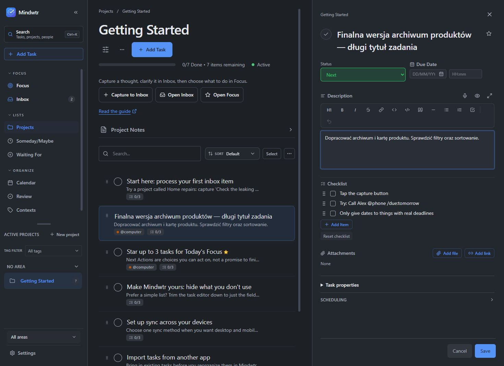
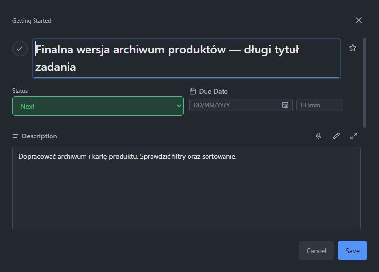

# Side-panel task editor

Settings → GTD → Task editor layout → Editor opening adds Side panel alongside In-row and Pop-up. It docks beside the list at 1280px and wider, and fills the workspace below that width. Calendar and Daily/Weekly Review keep inline editors. The existing draft, save/discard confirmation, field configuration, title suggestions and attachment handling are shared.

The panel shows configured status, due date, description, checklist and attachments first. Other properties and scheduling remain available. Hidden fields stay hidden. Task titles can wrap. Edited rows remain mounted when a virtualized list scrolls, including repeated tag/context rows; closing the panel restores the task control's focus. Sandbox settings display the stored mode correctly.

The original UI is source 5ccbffa. Follow-up safety fixes have focused regressions for virtual ranges and draft identity, review-guide presentation, keyboard focus and the sandbox selector. Build/installation readback and owner native acceptance are tracked separately in the coordination task; screenshots show isolated browser sample data.

Rollback can switch Editor opening back to In-row or Pop-up. Installation rollback replaces only the previous EXE; never restore an older database over newer user data. No dependency or database migration is introduced.
